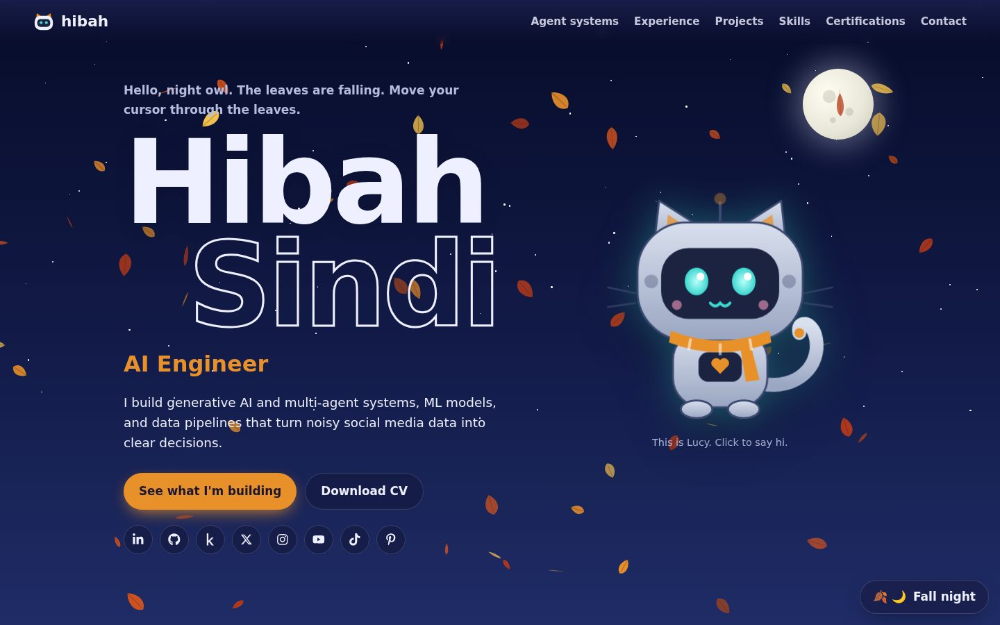
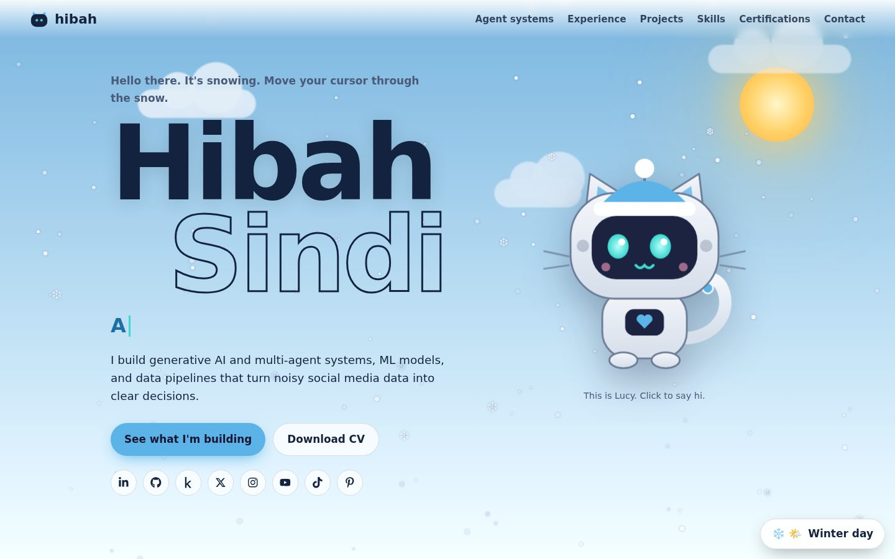
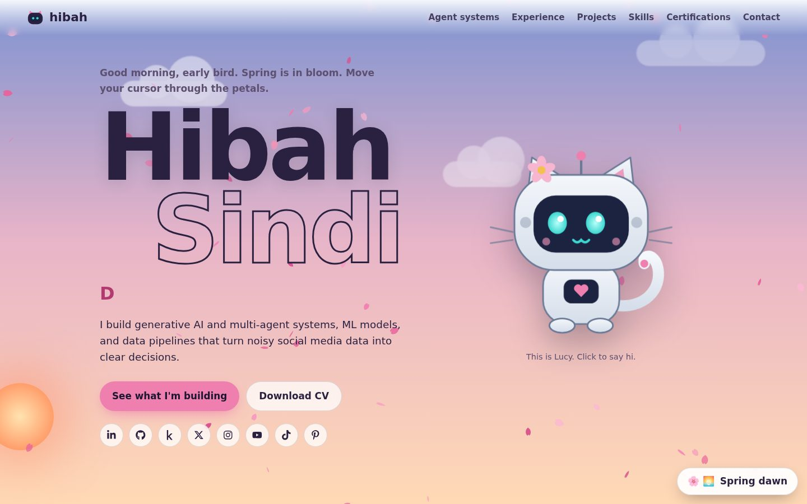
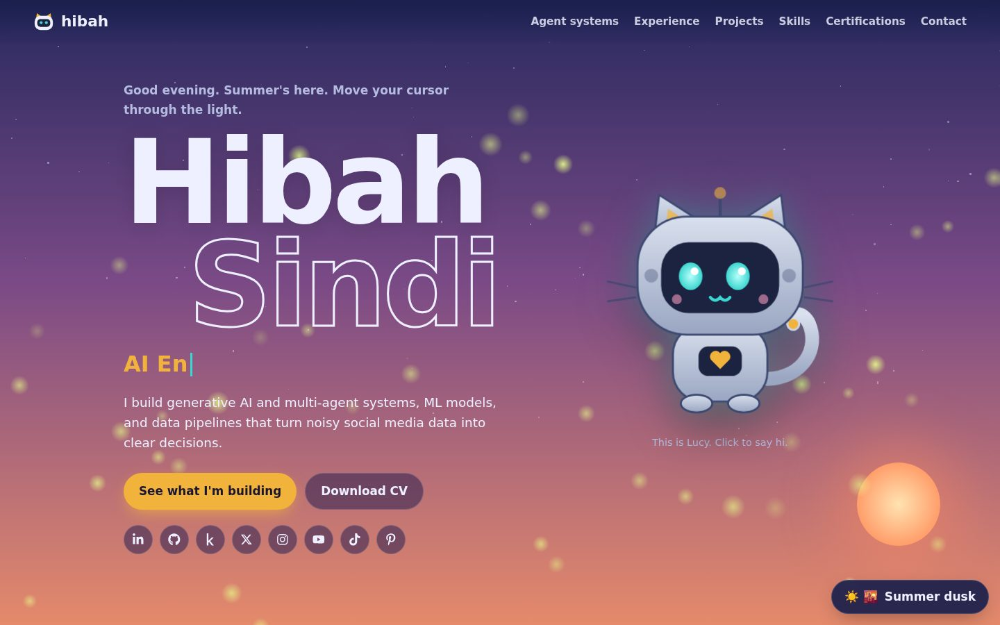
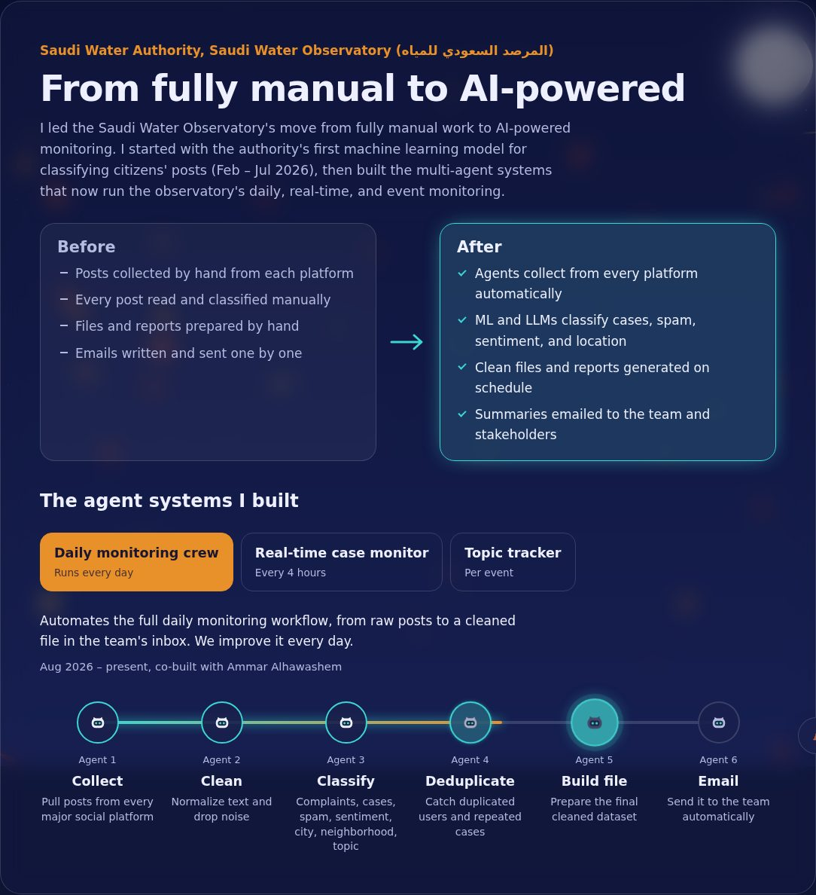

<div align="center">

# Hibah Sindi | AI Engineer & Data Analyst

**A living portfolio that changes with the seasons and the time of day, guarded by Lucy, my robot cat.**

[**View the live site**](https://hibah-portfolio-one.vercel.app/) · [Download my CV](https://hibah-portfolio-one.vercel.app/Hibah_Sindi_CV.pdf) · [LinkedIn](https://www.linkedin.com/in/hibah-sindi/)




</div>

## About me

I'm an AI Engineer and Data Analyst in Riyadh. At the Saudi Water Authority, I led the Saudi Water Observatory (المرصد السعودي للمياه) from fully manual work to AI-powered monitoring, building the authority's first ML classification model and the multi-agent systems that now collect, classify, and report on social media data every day.

Before that, I co-founded Kaleem.AI and built its product end to end with Next.js, FastAPI, and CrewAI. I hold 15+ professional certifications, including TensorFlow Developer, Databricks Data Engineer Associate, Azure AI Fundamentals, and Oracle Agentic AI.

I love robots, AI, and cats, so I built a portfolio with all three.

## A site that lives in real time

The page reads each visitor's clock and changes to match their season and time of day.

| Fall night | Winter day |
|---|---|
|  |  |
| **Spring dawn** | **Summer dusk** |
|  |  |

| Season | What falls from the sky | Lucy wears |
|---|---|---|
| Fall (Sep – Nov) | Autumn leaves | A scarf |
| Winter (Dec – Feb) | Snow | A beanie |
| Spring (Mar – May) | Cherry petals | A flower |
| Summer (Jun – Aug) | Floating seeds by day, fireflies at night | Sunglasses |

The sky follows the clock too: a peach dawn (5–8), a bright blue day with drifting clouds (8–17), a violet dusk (17–19), and a starry night with the moon (19–5).

## Features

- **Lucy, the robot cat.** Her eyes follow your cursor, she blinks and swings her tail, her eyes glow at night, and she dresses for the season. Click her and she talks.
- **Interactive particles.** Leaves, snow, and petals drift away from your cursor.
- **Scene switcher.** A button in the corner lets visitors preview every season and time of day.
- **Animated agent pipelines.** My Saudi Water Authority systems are shown as robot agents that light up step by step, with a before-and-after view of the move from manual to AI-powered work.
- **Paw prints.** Click any empty space and a paw print appears.
- **Accessible.** Keyboard friendly, screen-reader labels, and all motion turns off for visitors who choose "reduce motion" on their device.
- **Responsive.** Designed for phones, tablets, and desktops.



## Built with

- **Next.js 15** (App Router) and **React 19**
- **Canvas API** for the seasonal particles
- **Hand-built SVG** for Lucy, the sky, the sun, and the moon
- **Plain CSS** with custom properties for the season and time themes
- **react-icons** for the social icons
- **Fredoka** and **Atkinson Hyperlegible** from Google Fonts
- Deployed on **Vercel**

No animation libraries: every effect is written by hand.


## Project structure

```
app/
  layout.js          Page shell, fonts, and the script that sets the scene before first paint
  page.js            Puts all the sections together
  globals.css        Colors, themes, and styles
components/
  Sky.jsx            Sky gradients, sun, moon, stars, and clouds
  SeasonCanvas.jsx   Leaves, snow, petals, seeds, and fireflies
  RoboCat.jsx        Lucy and her lines
  Systems.jsx        Before and after, plus the animated agent pipelines
  SceneControls.jsx  The season and time switcher
  SocialLinks.jsx    Social media icons
lib/
  data.js            All the content: experience, projects, skills, certifications
  scene.js           Which months and hours map to which scene
public/
  Hibah_Sindi_CV.pdf My CV
  screenshots/       Images used in this README
```

All the text on the site lives in `lib/data.js`, so updating the content never means touching the components.

## Let's connect

I'm open to AI engineering, ML, and data roles in Riyadh, hybrid, or remote.

- Email: [hibahsindi@gmail.com](mailto:hibahsindi@gmail.com)
- LinkedIn: [linkedin.com/in/hibah-sindi](https://www.linkedin.com/in/hibah-sindi/)
- GitHub: [github.com/hibahdesu](https://github.com/hibahdesu)
- Kaggle: [kaggle.com/hibah1996](https://www.kaggle.com/hibah1996)
- X: [@hibah_sindi](https://x.com/hibah_sindi)
- YouTube, Instagram, and TikTok: [@en_la_programacion](https://www.youtube.com/@en_la_programacion)

<div align="center">

Made with curiosity, code, and cat treats by Hibah Sindi.

</div>
